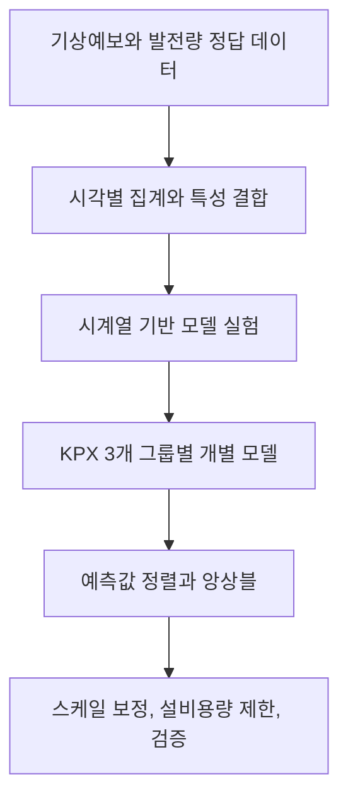

# 풍력발전량 예측

[English](README.md) | **한국어**

[DACON BARAM 2026 경진대회](https://dacon.io/competitions/official/236727/overview/description)를 위해 구축한, 시간별 풍력발전량을 예측하는 정형 데이터 기반 머신러닝 워크플로입니다.

LDAPS와 GFS 기상예보를 시각별 특성으로 변환하고, KPX 그룹마다 별도의 회귀 모델을 학습합니다. 시계열 검증을 통해 특성 구성, 앙상블, 보정 방법을 비교합니다.

## 프로젝트 한눈에 보기

| 항목 | 구현 내용 |
|---|---|
| 예측 대상 | `kpx_group_1`, `kpx_group_2`, `kpx_group_3` |
| 입력 | LDAPS/GFS 기상예보와 달력 특성 |
| 모델 계열 | RandomForest, LightGBM, CatBoost, XGBoost |
| 주요 로컬 데이터 분할 | 2024년 이전 데이터로 학습하고 2024년 데이터로 검증 |
| 기록된 앙상블 | 튜닝한 LightGBM과 특정 기상 특성을 사용한 LightGBM을 동일 가중치로 결합 |
| 출력 제약 | 예측값을 0 이상, 그룹별 설비용량 이하로 제한 |
| 실험 산출물 | 모델, 예측값, JSON 요약을 로컬에 저장 |

문서는 방법론, 재현성, 구현 과정의 의사결정을 중심으로 설명합니다. 원래의 개발 기록도 저장소에 보존되어 있습니다.

## 모델링 흐름



1. 기상 격자 값을 `forecast_kst_dtm` 기준으로 집계하고, 정답 데이터 또는 제출 양식의 시각과 결합합니다.
2. 달력 정보와 기상예보 평균값을 결합하고, 바람 벡터 및 특정 기상 특성을 추가한 구성을 비교합니다.
3. 학습 구간에서 중앙값 대체기를 학습하고, 각 예측 대상에서 정답값이 있는 행을 사용해 모델을 하나씩 학습합니다.
4. 예측 오차와 정산 관련 평가 특성을 함께 살펴봅니다.
5. 앙상블에 참여하는 예측값을 공식 제출 양식에 맞춰 정렬한 뒤 결합하고, 선택한 후처리를 적용합니다.
6. 생성한 제출 파일의 구조와 예측값 범위를 검증합니다.

모듈별 역할, 특성 계산식, 평가 방식은 [모델 설계 문서](docs/MODEL_DESIGN.md)를 참고하세요.

## 실험에서 살펴보는 질문

| 질문 | 실험 방향 |
|---|---|
| 어떤 모델 계열을 기준 모델로 삼을 수 있을까? | RandomForest, LightGBM, CatBoost, XGBoost 비교 |
| 바람 관련 변수를 추가하면 도움이 될까? | 풍속·풍향 파생 변수와 특정 고도에 초점을 맞춘 특성 |
| 특성의 다양성이 앙상블에 도움이 될까? | 튜닝 모델과 특정 기상 특성 모델의 결합, 가중치 탐색, XGBoost의 선택적 포함 |
| 보정 효과가 다른 기간에도 유지될까? | 공통 스케일 보정, 그룹별 스케일 보정, 연도별 순차 검증 |
| 학습 구성을 다양하게 하면 안정성이 높아질까? | 여러 랜덤 시드와 회귀 목적함수 변형 |

특성을 추가할 때는 조건을 통제한 비교가 필요하고, 앙상블의 다양성은 동일한 행에 정렬된 예측값으로 평가해야 합니다. 또한 한 해에서 선택한 보정 방법은 다른 기간에서도 검증해야 합니다. 연도별 순차 검증 실험은 실제로 평가 가능한 구간이 여러 개일 때만 여러 해에 걸친 결론을 뒷받침할 수 있습니다.

[실험 가이드](docs/EXPERIMENT_GUIDE.md)에서 각 질문에 대응하는 스크립트와 실험 확장 방법을 확인할 수 있습니다.

## 빠른 시작

모든 명령은 저장소 루트에서 실행합니다. 주요 LightGBM 실행 경로에는 Python, NumPy, pandas, scikit-learn, LightGBM, joblib이 필요합니다. CatBoost와 XGBoost는 각각의 비교 스크립트에서 사용합니다.

`requirements.txt`는 개발용 의존성을 포함한 원래의 버전 고정 환경을 UTF-16 인코딩으로 보존하고 있습니다.

```powershell
python -m venv .venv
.\.venv\Scripts\Activate.ps1
python -m pip install -r requirements.txt
```

데이터 없이 평가 지표 구현을 점검하려면 다음 명령을 실행합니다.

```powershell
python src/dacon_wind/metric.py
```

모델 학습에는 사용 권한이 있는 대회 입력 데이터를 로컬에 준비해야 합니다. 데이터셋을 자동으로 다운로드하는 기능은 없습니다. 필요한 입력, 전체 명령 실행 순서, 생성되는 산출물, 문제 해결 방법은 [재현 가이드](docs/REPRODUCIBILITY.md)에 정리되어 있습니다.

### 로컬 검증

```powershell
python scripts/train_lgbm_cv.py
```

이전 연도 데이터로 기준 모델을 학습하고 2024년 데이터로 평가합니다. 검증 예측값, 모델 번들, JSON 실행 요약을 저장합니다.

### 기록된 앙상블과 제출 파일 생성 절차

```powershell
python scripts/train_lgbm_tuned_submit.py
python scripts/train_lgbm_targeted_weather_submit.py
python scripts/create_ensemble_submission.py
python scripts/create_ficr_postprocess_submission.py
python scripts/create_scale_110_submission.py
python scripts/validate_submission.py submissions/lgbm_008_scale_110.csv
```

중간에 생성되는 1.03배 보정 파일은 1.10배 보정 스크립트에서 비교와 행 정렬에 사용합니다. 최종 예측값은 원래 앙상블 예측값에 1.10을 직접 곱해 계산합니다.

제출 파일 생성 스크립트는 고정된 산출물 이름을 사용하며 기존 출력을 덮어쓰지 않습니다. 이전 실행 결과를 보존하고, 전체 절차를 재현할 때는 새로운 작업 사본을 사용하세요.

## 저장소 안내

| 경로 | 역할 |
|---|---|
| [`src/dacon_wind/data.py`](src/dacon_wind/data.py) | 로컬 정답·기상·제출 양식 데이터 읽기와 시각 파싱 |
| [`features.py`](src/dacon_wind/features.py) | 달력, 격자 집계, 기상 파생 특성 |
| [`cv.py`](src/dacon_wind/cv.py) | 주요 시계열 학습·검증 구간 마스크 |
| [`metric.py`](src/dacon_wind/metric.py) | 그룹별 설비용량, 평가 대상 행, 종합 평가식 |
| [`models.py`](src/dacon_wind/models.py) | RandomForest/LightGBM 공통 학습 도우미 |
| [`scripts/`](scripts/) | 모델 실험, 제출 파일 생성과 검증 |
| [`notebooks/`](notebooks/) | 기준 모델 및 평가 지표 참고 노트북 |
| [모델 설계](docs/MODEL_DESIGN.md) | 데이터 흐름, 특성 구성, 모델·평가의 입출력 규약 |
| [재현 가이드](docs/REPRODUCIBILITY.md) | 환경, 입력, 명령, 출력, 자주 발생하는 오류 |
| [실험 가이드](docs/EXPERIMENT_GUIDE.md) | 실험 구성과 확장 절차 |
| [출처](docs/SOURCES.md) | 공식 대회, 데이터, 규칙, 평가 지표 참고 자료 |

[실험 기록](docs/experiment_log.md), [실험 피드백](docs/experiment_feedback.md), [워크플로 메모](docs/workflow.md), `start-plan.md`, `AGENTS.md`, `prompts/`에는 원래의 개발 맥락이 보존되어 있습니다. 날짜가 표시된 상태 메모는 해당 시점의 프로젝트 상태를 설명합니다.

## 로컬 데이터와 산출물

대회 입력 데이터는 `data/raw/`, 모델 번들은 `outputs/models/`, 예측값은 `outputs/predictions/`, JSON 요약은 `outputs/logs/`, 최종 CSV는 `submissions/` 아래에 저장합니다.

이 파일들은 Git 추적에서 제외됩니다. 데이터셋이나 생성된 예측값을 재배포하지 않아도 코드의 흐름을 이해할 수 있도록 입력 파일명과 산출물 경로를 문서에 설명합니다.

## 기술적 고려 사항

- 주요 홀드아웃 검증 구간은 한 해입니다. 같은 검증 구간에서 특성, 앙상블, 스케일 보정을 반복해서 선택하면 해당 구간에 과적합될 수 있습니다.
- 기상 데이터 집계에서는 `data_available_kst_dtm`을 제외하며, 데이터 이용 가능 시각에 따른 필터를 적용하지 않습니다. 예측 기준 시각까지 이용 가능한 데이터만 선택하는 계층을 추가하는 것이 유용한 후속 개선 방향입니다.
- 그룹별 스케일 보정은 보정의 유연성을 높이지만, 모든 그룹에 공통 스케일을 적용하는 방식보다 과적합되기 쉽습니다.
- CSV 검증기는 파일 형태, 열 순서, 결측값·숫자가 아닌 값, 설비용량 범위를 점검합니다. 앙상블·후처리 스크립트는 예측 ID와 시각의 정렬을 별도로 확인합니다.
- 제출용 학습 스크립트는 사용 가능한 전체 학습 정답 데이터로 모델을 다시 학습합니다. 하이퍼파라미터 탐색이나 전체 검증 실험을 다시 수행하지는 않습니다.
- 전체 학습과 추론에는 로컬 대회 데이터와 원래의 실행 환경이 필요합니다. 이 문서 변경에는 전체 데이터를 이용한 새로운 학습 실행이 포함되어 있지 않습니다.
